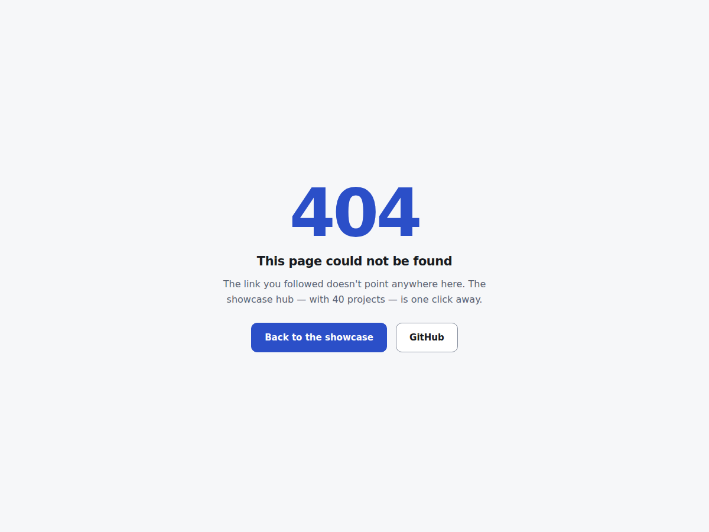

# Companion Forge

<!-- shot:start -->



<!-- shot:end -->

[](https://drsamonline.github.io/app-companion-forge/)
[](LICENSE)
[.

## What it does

Open the console and you get the whole system at a glance:

- a **summary** — items done, queue remaining, kits live, fleet size, average
  conformance score, blocked items;
- the **build queue** — every item with its kit dependencies, status and whether
  it is runnable right now;
- the **kit graph** — each kit with its consumer apps;
- the **repo fleet** — role, conformance score and visibility.

Search any view, export it to CSV, switch language (English / हिन्दी / ગુજરાતી) and
theme. Everything is local; the app never calls the network.

## Run it

Open `docs/play/index.html` in a browser. That's the whole app — the engine
(`docs/play/forge.js`), the bundled snapshot (`docs/play/data.js`) and the shared
runtime (`docs/play/web-kit.js`) sit next to it, so it works from `file://` and
from GitHub Pages.

```
node test-node.js      # 30 passed, 0 failed
```

## How it is built

The app is **thin**: all the common behaviour (storage, languages, CSV, theme,
accessibility) comes from **web-kit**; the only app-specific code is

- `docs/play/forge.js` — a small, pure, zero-dependency engine that reads the
  snapshot: `statusOf`, `isRunnable`, `nextRunnable`, `summarize`, the row
  builders, `search` and `toCSV`. It runs unchanged in the browser and under Node,
  so it is unit-tested headlessly;
- `docs/play/data.js` — a read-only snapshot generated from `forge` and `registry`
  by `gen_data.py`. It is bundled, never fetched.

## Build the EXE and APK

This repo calls the shared build workflow. On every push, GitHub Actions builds a
portable Windows EXE and a signed Android APK from `docs/play` and attaches them
to the `app-latest` release.

## Support


Free, offline, accountless — and staying that way. If it earned its keep:

| | |
|---|---|
| UPI (India) | `drsohilboi@ybl` — payee Dr. Sohil Momin, open amount, or scan [the QR](docs/assets/upi-qr.svg) |
| Ko-fi | [ko-fi.com/matneo](https://ko-fi.com/matneo) |
| PayPal | [paypal.me/drsohilmomin](https://paypal.me/drsohilmomin?locale.x=en_GB&country.x=IN) |
| My books | [Amazon author store](https://www.amazon.com/stores/author/B08ZT331LY/allbooks?ccs_id=aed72b9f-71d9-41dc-adee-e9368a317acc) |
| More apps | [drsamonline.github.io](https://drsamonline.github.io/) |
| Email | [sohilmomin2000@gmail.com](mailto:sohilmomin2000@gmail.com) |

Nothing is gated behind it: no accounts, no tracking, no network requests.

## Licence

MIT. (c) 2026 Dr Sohil Momin. Part of the Forge system — apps open, orchestrator licensed.
